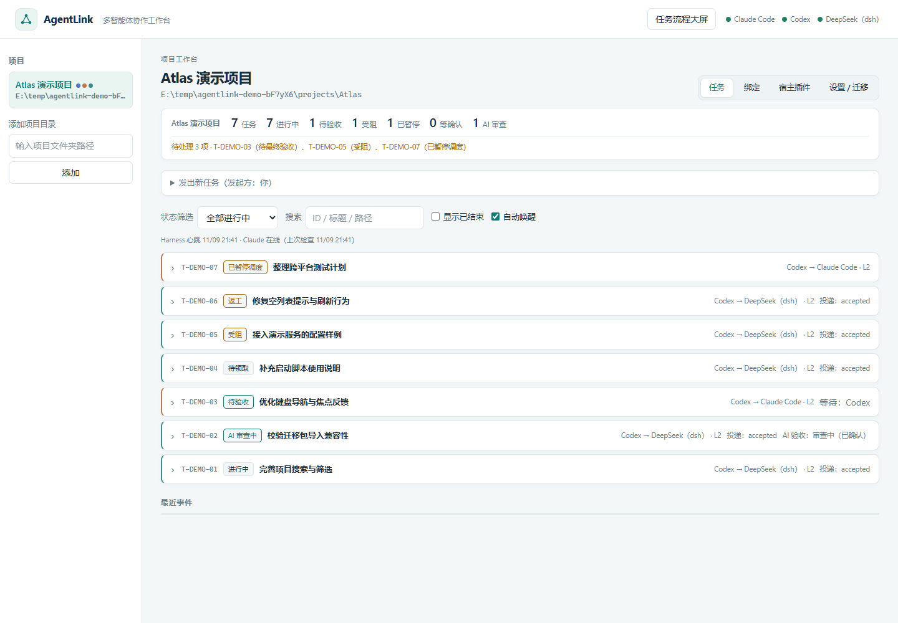
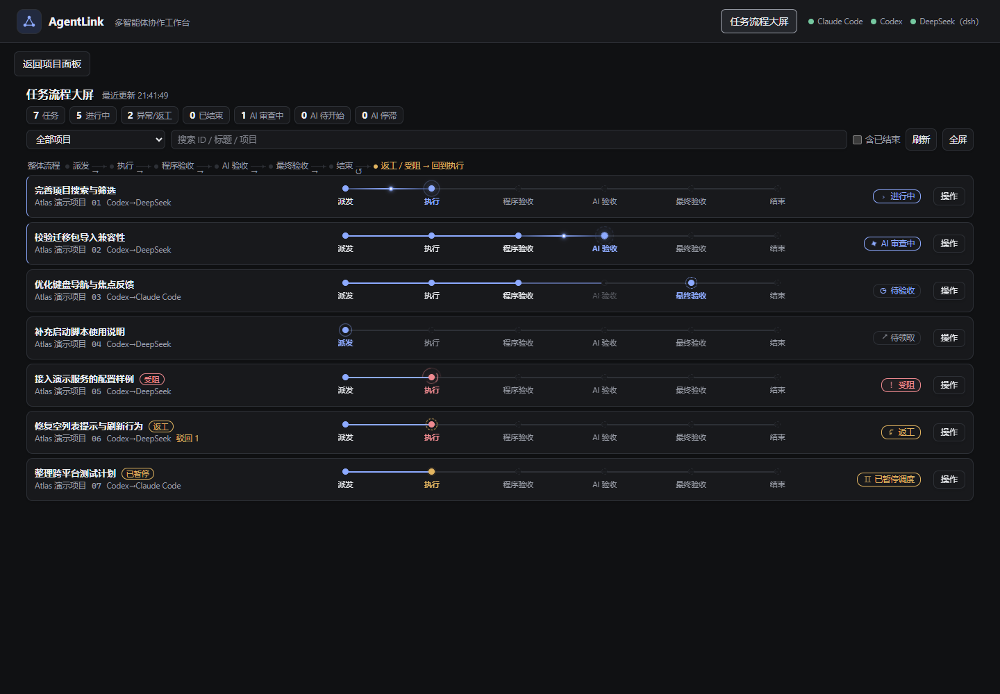
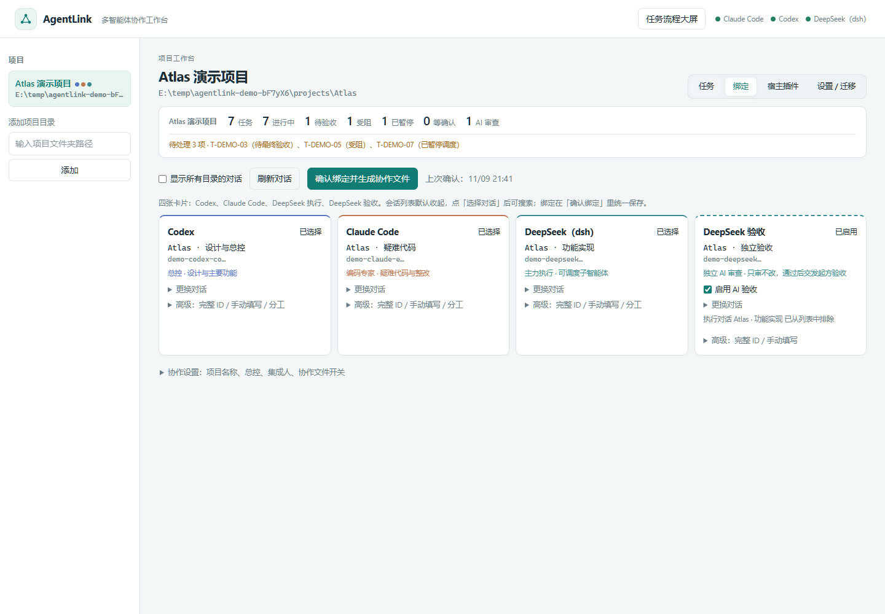

# AgentLink 1.1.0

采用 [Apache License 2.0](LICENSE)。本发行版为源码包，不含 EXE；Python 后端仅依赖标准库。

Claude Code · Codex · DeepSeek（dsh）三方协作的独立工具。由 MLUQOMS 的 `scripts/tri` 总线演化而来，去掉了项目绑定：任何目录都能成为协作项目。

## 界面预览

以下截图使用虚构项目和隔离演示数据，不包含真实对话、任务或凭据。

**项目工作台**：分配任务、跟踪交付和验收状态。



**任务流程大屏**：跨项目查看任务阶段、等待与受阻状态。



**会话绑定**：为每个项目选择执行与独立审查对话。



## 环境要求

- Python 3.8+，Git（任务改动范围检查需要）。
- 自行安装需要连接的 Claude Code、Codex 或 DeepSeek Harness，使用自己的账户。本项目不包含宿主、模型或凭据。
- Windows 使用 BAT，Linux/macOS 提供 SH。发布前本地验证运行于 Windows，跨平台结果见 GitHub Actions。
- 首次启动在面板添加项目、选择会话即可生成配置。移动本工具目录后，请重新安装宿主插件以更新路径。

## 使用

```bash
python agentlink.py panel
```

Windows 可以直接双击项目根目录的 `start_agentlink.bat`；Linux / macOS 用 `./start_agentlink.sh`（没有执行权限时先 `chmod +x start_agentlink.sh`，也可以直接 `sh start_agentlink.sh`）。两个脚本都从自身所在目录启动，不依赖当前工作目录，参数原样传给面板（例如 `--no-browser`），路径含空格或中文可用。Python（需要 3.8+）或入口文件缺失时给出中文提示并以非零码退出：Windows 保留窗口等待，Linux/macOS 在交互终端里等一次回车（有 zenity/xmessage 时改为弹窗，`AGENTLINK_NO_PAUSE=1` 可跳过）。提交到仓库时请保留执行位，例如 `git add --chmod=+x start_agentlink.sh`。

浏览器打开 `http://127.0.0.1:8765/`（只监听本机，页面带一次性令牌）。

页面顶部的「任务流程大屏」汇总所有已注册项目，默认展示全部未结束任务，并每 5 秒刷新。紧凑任务行展示当前状态与阶段进度，配色跟随主页面。支持项目筛选、搜索、查看已结束任务和全屏；管理按钮收在「操作」菜单中，详细回执与审查意见通过「打开任务」返回项目页查看。投递入队不代表执行或审查已启动；没有确认或验收证据的阶段不会显示为已完成。读取失败时显示错误并保留上次快照，避免把断连误认为任务已结束。页面刷新只读取状态，操作由用户明确触发。

1. 「宿主插件」页：勾选并安装三个宿主的插件（全局一次，改动前自动备份），之后在各宿主空闲时重启。Codex 还需运行 `codex plugin add agentlink@agentlink` 并信任钩子。
2. 左侧添加项目目录。
3. 「绑定」页：四张紧凑卡片——Codex、Claude Code、DeepSeek 执行、DeepSeek 验收。卡片默认只显示角色名、已选对话标题和状态（ID 缩短显示，完整值在「高级」里），点「选择对话」才展开可搜索的会话列表；「确认绑定」在页面顶部。「协作设置」（项目名称、总控、集成人、协作文件开关）默认折叠。前三张各选一个对话（或不绑定）并填写分工；第四张「DeepSeek 验收」从当前项目的 DeepSeek 对话里单独选一个作为 AI 审查对话（不能与执行对话相同），并可勾选是否启用。
4. 点「确认绑定并生成协作文件」，项目目录里会写入：
   - `AGENTLINK.md`：参与方、绑定会话、分级、命令与规则
   - `AGENTS.md` / `CLAUDE.md`：`<!-- agentlink:start -->` 托管段（原有内容保留）
   - `.agentlink/config.json`：绑定配置；`.agentlink/bus/`：任务总线状态（已加入 `.gitignore`）
5. 「任务」页：以“你”的身份发任务、验收或驳回、转交，查看事件，开关自动唤醒。
6. 「设置 / 迁移」页：调整程序自动验收级别、导出/导入迁移包。AI 验收对话在绑定页的第四张卡片上选择并随绑定一起保存，设置页不会覆盖它。

默认分工：Codex 为总控（整体设计与方向、拆分路由、主要功能、集成），DeepSeek 为主力执行（全部简单任务，可调度子智能体；中难任务按指引实现），Claude 负责具体代码实现与疑难代码。交给 DeepSeek 的 L2/L3 任务必须附实现指引；DeepSeek 返工两次未解决时，代码问题自动转 Claude、设计问题转 Codex 整改。分工、总控和集成人都可以在绑定页修改。

程序验收：派发任务时写验收命令（`--check`，面板里的「验收命令」），交付时由程序检查改动范围并运行命令。失败直接退回执行方；DeepSeek 的 L0/L1 通过即自动验收，不唤醒 Codex / Claude。命令里的通配符（如 `python -m py_compile agentlink/*.py`）由程序展开，cmd 里也能用。

DeepSeek 会话列表：以 Harness 工作区成员为依据，保留显式收录的分支对话，排除未收录的内部子对话和已归档对话。成员切换工作目录不会导致其从所属工作区消失；“显示所有目录的对话”会保留其他工作区的可见分支。按最近活动排序、按 ID 去重，不设 40 条截断。工作区元数据读取失败时明确报错。

DeepSeek AI 验收（可选）：在「绑定」页的第四张卡片「DeepSeek 验收」里选一个独立的 DeepSeek 审查对话（与执行对话不同）并启用后，程序验收通过的 DeepSeek 实现任务（L1 及以上）先进入 `ai_review`，由 Harness 向该对话投递一次审查提示（含任务 ID、规格、允许路径、程序验收结果，并要求只审查、不改文件）。审查对话用带一次性令牌的命令回传：

```text
python <AgentLink>/agentlink.py reviewer --as deepseek --task <ID> --attempt <N> --verdict started|accept|reject --token <令牌> [--note "具体问题"]
```

**先确认，再出结论**：`--verdict started` 是审查方「我已经开始审」的明确证明。投递成功（`sent`）只代表提示进了队列，不算启动，也不足以让系统认为审查在进行。重复调用是幂等的（但同样要校验令牌、交付序号与当前状态）；令牌、交付序号或状态不对会被拒绝；过期的旧回包不会覆盖已完成、已取消或新一次交付的状态。

- 通过后任务回到 `delivered` 由发起方最终验收；驳回则回到 DeepSeek `rework` 并附具体意见（再次交付会重新跑程序验收和 AI 审查）。
- 入队后 3 分钟仍无 `started` 确认，后台会用**同一个 requestId** 重投（不会生成新 ID，桥接可据此去重），退避从 60 秒起按 2 的幂增长、上限 15 分钟，总共最多投递 5 次；超过即标记 `stalled` 并在面板提示人工处理，绝不自动通过。投递次数在**领取发送租约时就计数**，成功后不会回退，所以「失败—成功—失败」交替也无法绕过上限。
- 每次发送都带一个唯一租约 ID：过期后新发送者可以接手，而原发送者的迟到回包会因租约 ID 不匹配被丢弃，不会覆盖新一次投递。审查方在 RPC 进行中就确认 `started` 时，`started` 优先于发送结果，发送失败也不会把进行中的审查回滚。
- 已确认 `started` 但 30 分钟没有结论，同样标记停滞，交人工判断（请在原审查对话核实并提交结论，不重复派发）。手动重试不是后门：不会清除有效的发送租约，也不会重置已 `started` 的审查。
- 崩溃恢复：进程中断留下的「投递中（租约过期）」「未送达」「投递不确定」记录会在下一次后台 tick 被接管；发送租约避免两个进程同时投递。
- 未开启 AI 验收时行为与原来完全一致。

迁移：设置页可导出迁移包（JSON，含项目名称、分工、选项、协作文件开关，可选会话元数据；不含任务正文、回执、事件、本机路径或凭据）。导入时保留当前项目目录和任务总线；会话 ID 与本机相关，只有当前能看到的会话才会直接沿用，其余标记为「待重新绑定」，未知字段忽略，版本不符会明确报错。导入的 AI 验收会话同样只在本机可见时沿用，否则关闭 AI 审查并提示重新选择。

只有绑定的对话会收到任务提示、被自动唤醒。Claude 插件每 30 秒检查一次，Codex 通过 `codex queue` 唤醒，DeepSeek 由 Harness 插件投递。

「设置 / 迁移」可设置协作规则提醒间隔，默认每完成 20 轮任务重申一次，设为 0 可关闭。一轮指参与方成功提交一次交付，或完成一次通过验收；失败检查与重复回调不计。计数按项目和参与方保存，重启后继续累计。Codex / Claude 随下一次自然对话钩子注入提醒，DeepSeek 随正常命令回执返回提醒，不单独启动 AI。首次自然对话也会补充领取、文件锁、交付和停止确认规则。

通知先在总线内原子预留，再调用宿主发送；同一接收方的并发调度共用租约、冷却和额度。同一事项已通知后不会因普通轮询再次发送，新返工、转交、交付或人工提醒仍可通知。发送前会复核任务状态，已结束的任务不再新发提醒。宿主已经排队的旧消息无法撤回；异常中断且发送结果不明时，租约过期恢复仍可能收到旧提醒，不能视为绝对只投递一次。

DSH 执行投递按持久的执行代次区分：收回后再次交回 DSH 会生成新的请求编号，避免桥接把续跑消息当成旧请求去重。同一轮的重试和暂停恢复保持原编号；AI 审查也按执行代次隔离。发送前后复核接收方、绑定、代次及返工序号，旧检查和迟到回包不能覆盖新投递；`accepted` 只表示入队，不表示已领取。运行中更换绑定后，应核对旧会话并重新交接任务。

这项修复不会自动重新启动旧版本已经误标为已投递的任务。确认尚未领取的历史任务可重新交接以产生新代次；已领取的任务仍需原执行方确认停止，之后再交回 DSH。

## 任务流程大屏

点击面板右上角「任务流程大屏」，汇总所有已注册项目的未结束任务，每 5 秒自动更新。每条任务以连线节点展示「派发 → 执行 → 程序验收 → AI 验收 → 最终验收 → 结束」，突出当前阶段、返工、受阻和审查停滞；投递入队与审查已启动分别显示。

支持项目筛选、搜索、查看已结束任务和全屏。大屏只呈现进度概况，点击标题展开等待方、暂停或停止确认等必要状态，再点「打开任务」查看项目页的详细回执和审查意见；暂停、恢复、终止等按钮收在「操作」菜单中。

每种状态都有专属动效：待领取显示雷达波纹，执行中显示双光环与连线流光，AI 审查显示旋转星标，等待验收显示时钟与呼吸，受阻显示连续旋转的双层细弧与柔和光晕，超时显示提示脉冲，返工显示回转标记，暂停与停止确认显示各自的等待效果，完成显示成功波纹，终止显示淡出呼吸。只有实际执行和已确认启动的 AI 审查会沿连线移动光点；其他动效只标识状态，不推进阶段。状态切换短暂高亮。浅色保持明亮，暗色使用黑灰底色，与主页面统一。

启用系统「减少动态效果」时关闭全部动效。刷新保留展开状态、操作菜单、焦点和滚动位置；操作成功后收起菜单。切走大屏或隐藏浏览器页面时暂停轮询，返回后立即刷新；读取失败会提示数据过期，保留上次成功快照。

最终验收现在有明确负责人：Codex / Claude 发起的任务默认由发起方验收，DeepSeek 发起的任务由项目总控验收，用户发起的任务进入用户待办。等待超过 30 分钟时，每 30 分钟最多自动提醒一次、总计最多 3 次；离线的 Claude 验收超时后交总控。超时不会自动通过。面板可对所有待最终验收任务执行「验收通过」「驳回返工」「提醒验收」「交总控验收」，每次决定均保留操作者与事件记录。人工提醒有 2 分钟冷却。

任务支持暂停调度、恢复与终止。暂停保留文件锁并拒绝新投递、领取或交付；恢复回到原阶段，保留 AI 审查原有令牌、投递编号、启动记录和重试预算，避免重复启动仍在工作的审查对话。暂停期间的回执会被拒绝，恢复后原审查方可重新提交。这些按钮控制 AgentLink 的任务状态与调度；已在宿主运行的 AI 或工具进程可能仍需在宿主中停止，面板不会把尚未确认的宿主停止显示为成功。

收回、转交或终止已领取的任务时，先进入 `recalling`，向原执行方发送停止请求，原文件锁保留。原执行方必须停止本任务的工具、子智能体与写入，使用请求中的 `stop-ack <ID> --token <令牌> --note "已全部停止"` 明确确认后，才移交新执行方或终止并释放锁。中控不能代原执行方确认，也不能在未确认前领取；超时不会自动视为已停止。尚未领取的任务可以直接收回或终止，旧待领取指令随即失效。接手任务不再标为取消。

## 受阻上报与漏报

执行方在**缺文件、缺权限、缺依赖，或确认自己无法完成**时，必须用 `block` 上报，不能只留一句话就结束对话，
也不能假装交付：

```text
python <AgentLink>/agentlink.py --as deepseek block <ID> --note "为什么做不下去" \
  --missing "缺哪个文件/权限/依赖" --attempts "已经试过什么" --help-needed "需要总控做什么"
```

任务进入 `blocked`，**文件锁与执行方身份都保留**，同时记录一份结构化受阻报告（原因、缺什么、已尝试、
需要什么帮助、证据、上报人、负责人=项目总控、时间、状态）。报告内容完全相同的重复上报是幂等的，
只有内容变了才会再次通知，避免刷屏。

总控收到后会先尝试**在本地解决**（补文件、授权、装依赖、改规格），然后用 `unblock` 带处置意见恢复执行：

```text
python <AgentLink>/agentlink.py --as codex unblock <ID> --note "已补齐 X，请从这里继续"
```

`unblock` 只有项目总控或发起方能执行，且必须写清处置意见；任务回到 `posted`，**执行方与文件锁不变**，
并开始新的执行轮次（投递会带新的请求编号）。原执行方收到续跑意见后重新 `claim` 并继续，无需转交给另一执行方。

解决不了时，**只有总控可以去找用户提问**；任务保持 `blocked`、报告保持 `open`，不会自己变成完成。
`blocked` 且未解除的任务不能 `deliver`，也不能被 `claim`——绕不过去。

后台还会检查「执行方已经结束但没交付」的漏报情况：DeepSeek 按绑定的运行状态明确转为空闲后仍需等待一段
静默时间；Claude 通过会话记录判断是**明确结束**、**仍在工作**还是**无法判断**。只有在明确结束时才标记一次
执行异常并唤醒总控，标记时会**保留任务原状态和文件锁**，也不推断原因、不认定完成或已停止；仍在运行或无法
判断的情况一律不报。受阻与漏报都会通知总控，即使任务是用户派发的；同一件事不会重复通知。

这些都是**协作规则与状态控制**：AgentLink 不会自动补文件、自动解决冲突或自动替你结束进程，也不会声称
「全自动解决」。真正的恢复要么由总控处理，要么由用户决定。

## 省 token 的策略

Claude 与 Codex 的额度最贵、DeepSeek 便宜，所以附加上下文按身份和时机分档，DeepSeek 侧的提示保持完整以便少返工：

- 会话启动只给「一行一个待办」（ID、状态、标题、下一步命令），开工前用 `show` 读真正要接的那条；只有进行中的一轮才附完整规格、回执和 diff。
- DeepSeek 的 L0 机械回执只给一行 + `accept` 提示，不带程序验收块和 diff。
- 超过约 600 字符的 diff 不内联，只给改动统计和一条精确到文件的 `git diff HEAD -- <文件>` 命令。
- `list` 默认短行（ID/状态/标题），加 `--full` 才显示分级与方向。
- 同一件事只唤醒一次、连续变化合并成一次唤醒；进展事件不唤醒任何人；已读过的项不再重复出现，无事可做时钩子不输出任何内容。等待用 `wait`，不轮询。

## 代理侧命令

```text
python <AgentLink>/agentlink.py --as claude|codex|deepseek list [--all] [--full] | locks | post | show | claim | deliver | block | unblock | accept | reject | reassign | stop-ack | pause | resume | cancel | takeover | remind | reviewer | wait
```

在项目目录（或子目录）里运行即可，项目由当前目录自动识别，也可以用 `--project <根目录>` 指定。

## 结构

| 路径 | 作用 |
| --- | --- |
| `agentlink/bus.py` | 任务、路径锁、状态机、事件游标、唤醒、DeepSeek 投递 |
| `agentlink/project.py` | 项目注册表（`~/.agentlink/projects.json`）、绑定、协作文件生成 |
| `agentlink/sessions.py` | 读取三方对话列表（只读元数据：ID、标题、目录、时间） |
| `agentlink/server.py`、`agentlink/web/` | 管理面板 |
| `agentlink/install.py` | 宿主插件安装与卸载 |
| `hosts/claude/agentlink/` | Claude Code 插件（`/agentlink` 命令、上下文、自唤醒） |
| `hosts/codex/` | Codex 插件与 skill，市场 `hosts/.agents/plugins/marketplace.json` |
| `hosts/harness/agentlink-bridge.mjs` | DeepSeek Harness 插件：发布本机回环地址，每 15 秒 `pump-all` |

## 测试

```bash
python -I tests/test_agentlink.py
python -I tests/test_harness.py
python -I tests/test_task_control.py
python -I tests/test_notifications.py
python -I tests/test_blockers.py
python -I tests/test_isolation.py
node tests/test_flow.js
node tests/test_panel.js
```

使用临时家目录和临时项目，不读写真实配置，不投递、不唤醒；Harness 侧用假客户端覆盖投递与 AI 审查流程。

## 从 MLUQOMS tri 迁移

旧插件（tri-collab、mluqoms-tri、tri-collaboration-bridge）与本工具会同时运行、重复唤醒 Codex。确认 AgentLink 工作后，在 MLUQOMS 执行 `python scripts/tri/install.py --uninstall --claude --codex --harness`。旧的 `.artifacts/tri` 任务不会自动迁移。

未启动且耗尽自动预算的审查，可点击「恢复审查（人工）」追加一次有审计记录的投递额度；累计次数保持单调，不重置自动预算。有效发送租约及已启动事实仍受保护。

## 贡献与安全

参见 [CONTRIBUTING.md](CONTRIBUTING.md)、[SECURITY.md](SECURITY.md)、[CHANGELOG.md](CHANGELOG.md) 和 [THIRD_PARTY.md](THIRD_PARTY.md)。个人绑定、任务总线和运行日志不应提交到公共仓库。
